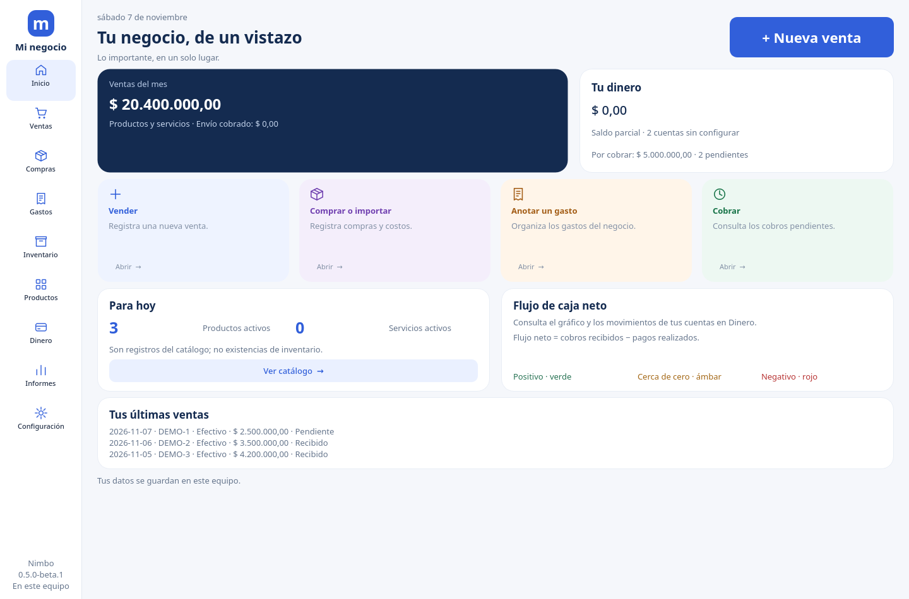
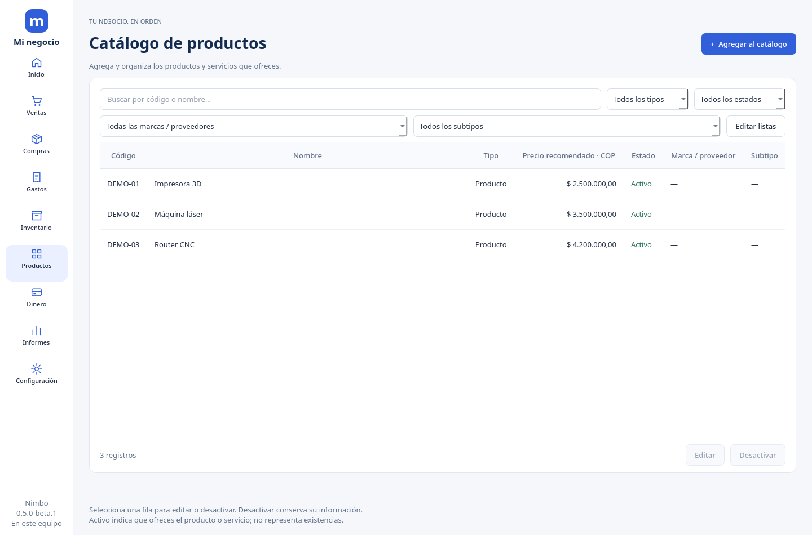
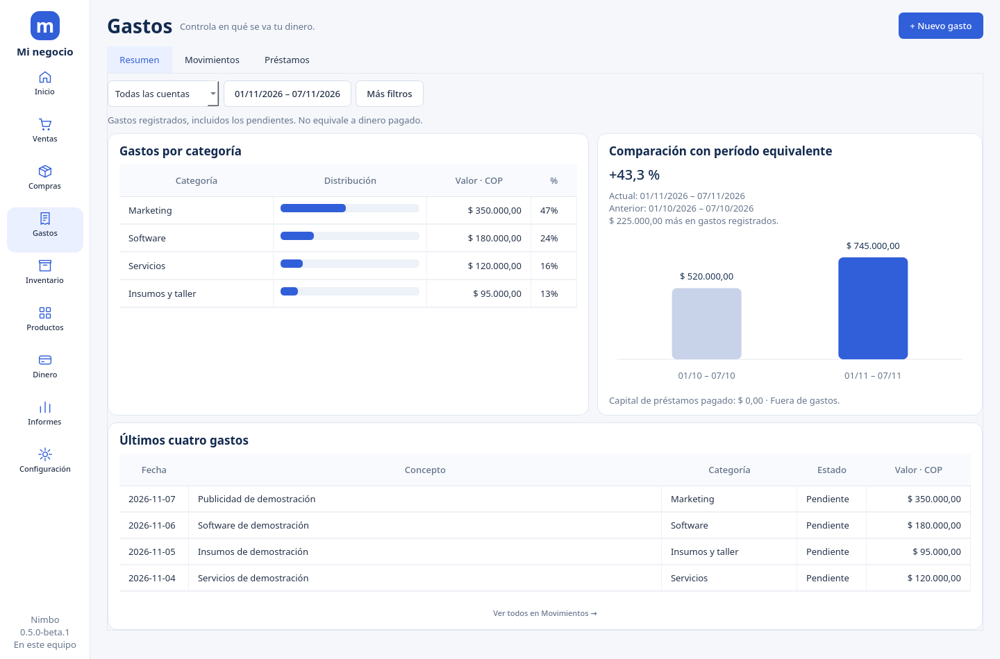

# Nimbo

**Tu negocio, de un vistazo.**

Nimbo es una aplicación de escritorio para emprendedores que quieren organizar
sus ventas, compras, inventario y gastos en un solo lugar. Nació para gestionar
un negocio de maquinaria e impresión 3D, con categorías y costos configurables
para adaptarse a otros emprendimientos.

Funciona con datos locales, sin depender de un servicio en la nube. Está escrita
en **Python y Qt / PySide6**, utiliza **SQLite** y su código se distribuye bajo
licencia **MIT**.

> **0.5.0-beta.1 · Primera beta.** Está disponible para evaluación. Haz una copia
> de seguridad antes de actualizar y prueba tus operaciones habituales antes de
> utilizarla con registros definitivos.



Las capturas de esta página proceden de la beta y utilizan exclusivamente datos
ficticios. La aplicación comienza sin esos registros.

## Qué puedes hacer

| Área | Funciones |
| --- | --- |
| **Ventas** | Registrar productos y servicios, clientes, cobros pendientes, comisiones, envíos, IVA y retenciones. Consultar gráficos y filtrar movimientos. |
| **Compras** | Registrar mercancía en COP o USD, proveedor y alias, guía de seguimiento y costos adicionales. Distribuir gastos entre modelos y recibir pedidos completos. |
| **Inventario** | Confirmar existencias iniciales, consultar unidades disponibles y en tránsito, y controlar cantidades al vender. Ajustes manuales habilitables desde Configuración. |
| **Catálogo** | Conservar tus códigos, marcas, subtipos y precios recomendados. Editar y activar o desactivar productos y servicios. |
| **Gastos** | Registrar gastos pagados o pendientes, categorías personalizadas y documentos. Consultar distribución por categoría y comparar períodos equivalentes. |
| **Dinero** | Consultar cuentas y movimientos, transferencias y flujo de caja; controlar préstamos y tarjetas separando capital e intereses. |
| **Informes** | Filtrar y exportar PDF de ventas, gastos, dinero y rentabilidad con valoración FIFO del inventario. |
| **Respaldos** | Crear y restaurar copias completas de la base y los documentos adjuntos. |

Las comisiones y los envíos registrados en las ventas se reflejan en Gastos para
no tener que introducirlos otra vez. Las reglas de costos de compra pueden
configurarse por subtipo, con excepciones por producto.

## Instalar la beta

Los paquetes preparados para esta versión son:

| Sistema | Archivo |
| --- | --- |
| Debian 13 · Intel/AMD de 64 bits | `Nimbo-0.5.0-beta.1-linux-x86_64.AppImage` |
| Windows 11 · Intel/AMD de 64 bits | `Nimbo-0.5.0-beta.1-windows-x86_64.zip` |
| Fuentes y licencias de dependencias | `Nimbo-0.5.0-beta.1-sources.zip` |

Consulta las descargas en [GitHub Releases](https://github.com/fandres/nimbo/releases).
La primera beta se publica como **versión preliminar**, con sus archivos SHA256.

### Linux

Da permiso de ejecución al AppImage y ábrelo desde el administrador de archivos.
También puedes ejecutarlo desde una terminal:

```bash
chmod +x Nimbo-0.5.0-beta.1-linux-x86_64.AppImage
./Nimbo-0.5.0-beta.1-linux-x86_64.AppImage
```

Si el sistema no puede montar el AppImage:

```bash
./Nimbo-0.5.0-beta.1-linux-x86_64.AppImage --appimage-extract-and-run
```

El paquete se construye en Debian 13. Otras distribuciones Linux necesitan su
propia comprobación; no se garantiza compatibilidad con Debian 12.

### Windows

Extrae **todo el ZIP** en una carpeta y abre `Nimbo.exe`. Conserva la carpeta
`_internal` junto al ejecutable. No necesitas instalar Python.

El ejecutable aún no tiene firma digital. Fue construido con herramientas de
Windows y probado bajo Wine; la prueba de esta beta en Windows 11 real está
pendiente. Consulta la [guía de comprobación](docs/releases/PRUEBA-WINDOWS11.txt).

## Un recorrido por Nimbo

### Catálogo propio

Conserva los códigos que ya usas en tu plataforma de facturación, incluidos los
ceros iniciales. Organiza productos por marca y subtipo. El precio recomendado
sirve de referencia: cada venta conserva su precio real.



### Entiende tus gastos

El resumen muestra dónde se concentra el gasto, la comparación con un período
equivalente y los últimos cuatro movimientos. La pestaña Movimientos permite
consultar el detalle; Préstamos separa el capital de los intereses.



El video de demostración se preparará más adelante.

## Primeros pasos

1. Configura las cuentas, formas de pago, categorías y costos que utiliza tu negocio.
2. Agrega tu catálogo de productos y servicios.
3. Confirma las existencias actuales desde Inventario. Hasta configurar el control,
   las ventas no descuentan existencias.
4. Registra compras y confirma su recepción; después registra ventas y cobros.
5. Consulta gastos, flujo de caja e informes. Guarda respaldos periódicos.

Nimbo conserva referencias de facturas electrónicas, pero **no las emite** ni se
conecta a la DIAN. La lectura automática de facturas y XML sigue pendiente.

## Datos, respaldos y actualizaciones

Los datos se guardan en el equipo del usuario, fuera del AppImage o del ZIP.
En Linux, la ubicación habitual es
`~/.local/share/Fandres/MiNegocio/` (puede variar con `XDG_DATA_HOME`). En Windows
se utiliza la carpeta de datos que Qt asigna a `Fandres/MiNegocio`.

El nombre interno `MiNegocio` se mantiene para conservar los datos de versiones
anteriores. Los adjuntos son **copias** organizadas por año y mes junto a la base.

Antes de actualizar, crea un respaldo completo. No abras una versión antigua
sobre una base que ya haya sido migrada. La aplicación impide abrir dos instancias
sobre la misma base local.

- [Guía de copias de seguridad y restauración](docs/guias/copias-de-seguridad.md)
- [Guía de informes](docs/guias/informes.md)
- [Alcance y validación de la primera beta](docs/releases/primera-beta.md)

## Estado y próximos pasos

Esta beta pasó **468 pruebas automatizadas** en Linux local, Debian 13 aislado y
Python/Qt de Windows bajo Wine. Los dos paquetes pasaron la prueba de arranque
con una base temporal. Esto no sustituye las pruebas en equipos reales.

La rentabilidad depende de la trazabilidad del costo: las existencias sin costo
conocido no se consideran gratuitas y los costos incompletos se identifican como
provisionales. El informe es una herramienta de gestión, no una liquidación fiscal.

Entre los pendientes están la contraseña opcional de acceso, códigos de barras,
importación/exportación del catálogo y lectura asistida de facturas electrónicas.
Consulta las [notas de futuras versiones](docs/releases/futuras-versiones.md).

## Ejecutar desde el código fuente

Requiere Python 3.11 o posterior. Desde la carpeta del proyecto:

```bash
python3 -m venv .venv
source .venv/bin/activate
python -m pip install -e '.[test]'
nimbo
```

En Windows, usa `python` para crear el entorno y
`.venv\Scripts\activate` para activarlo desde una terminal CMD.

Para ejecutar las pruebas en Linux sin escritorio:

```bash
QT_QPA_PLATFORM=offscreen python -m pytest -q
```

Las recetas de empaquetado usan Python 3.13 y las versiones fijadas en
[`packaging/requirements.txt`](packaging/requirements.txt). Consulta la
[guía de construcción](docs/releases/nimbo-alpha.md); sus antecedentes de alfas
se conservan como documentación histórica.

## Reportar problemas y colaborar

Al reportar un problema, incluye la versión, sistema operativo, escala de pantalla,
pasos para reproducirlo, resultado esperado y resultado observado. Utiliza datos
ficticios y oculta información personal en capturas. **No publiques tu base de
datos, facturas ni respaldos.**

Las sugerencias de emprendedores que prueben la aplicación ayudarán a orientar
las siguientes versiones.

## Licencia

Nimbo: [MIT](LICENSE), © 2026 **fandres323**.

Qt, PySide6, Shiboken y las demás dependencias conservan sus licencias propias.
Los paquetes incluyen los avisos correspondientes y permiten sustituir las
bibliotecas según las instrucciones de distribución.

- [Avisos de terceros](docs/releases/THIRD-PARTY-NOTICES.txt)
- [Sustitución de bibliotecas](docs/releases/REEMPLAZAR-BIBLIOTECAS.txt)

Si compartes los binarios, conserva sus avisos y acompáñalos con el archivo de
fuentes de la misma versión.
